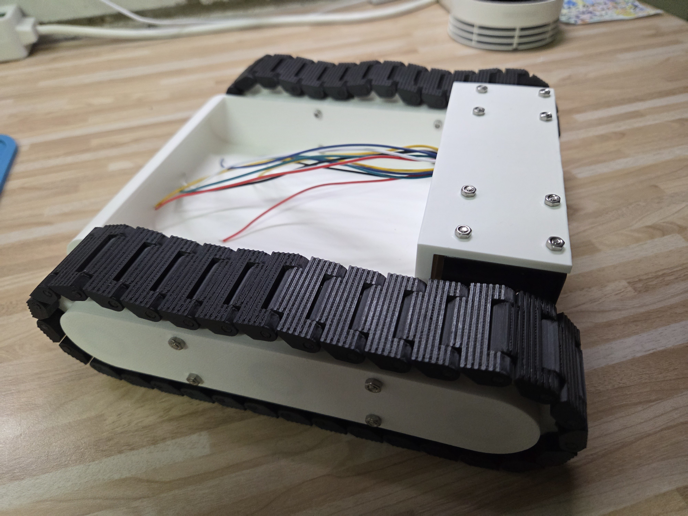

# explorer-robot

A tracked robot with LiDAR-based autonomous navigation and sensor-driven
obstacle avoidance, built in Rust on [Embassy](https://embassy.dev/) for the
RP2350B. It builds on hardware experience from
[simple-robot](https://github.com/1-rafael-1/simple-robot) and adds a 360° COIN-D6
LiDAR, two VL53L0X rangefinders, an ICM-20948 IMU, an ST7789 TFT with a resistive
touch panel, and a Grove Vision AI V2 camera — as much as fits on the custom PCB.

## Repository map

The repository is one tree with three Cargo workspaces, split by build target so
the robot's `thumbv8m` build never sees the RISC-V or host dependency graphs
([ADR-0040](docs/adr/0040-repo-and-build-layout.md)), plus the hardware sources
and the written material.

| Part | Directory | What it is | README |
|---|---|---|---|
| Robot firmware | `robot/`, root `Cargo.toml` | The `explorer-robot` Embassy firmware for the RP2350B (`thumbv8m.main-none-eabihf`) and its workspace crates: the Link Protocol, `LinkCore`, the drivers and the host-testable models | [robot](robot/README.md) |
| Bridge | `bridge/` | Its own workspace: the ESP32-C3 RISC-V firmware (`riscv32imc-unknown-none-elf`, `build-std`) that translates between the home network and the robot's UART1, and the HAL-free `bridge-core` rules | [bridge](bridge/README.md) |
| Remote | `remote/` | Its own host workspace (`x86_64-unknown-linux-gnu`): the `remote-daemon` relay, the shared `bridge-net` network edge, the two bench stubs and the static app | [remote](remote/README.md) |
| Hardware | `hardware/` | FreeCAD chassis and running gear, KiCad schematic and PCB, BOM, print notes, assembly photos and safety notes — no Cargo target | [hardware](hardware/README.md) |
| Documentation | `docs/`, `CONTEXT.md` | The docs index, [architecture and data flow](docs/architecture.md), the [component pages](docs/README.md#component-pages), the [ADRs](docs/adr/), and the [domain glossary](CONTEXT.md) — no Cargo target | [docs](docs/README.md) |

The robot workspace holds `link-protocol` and `link-core` under
`robot/crates/link/`, the async drivers under `robot/crates/drivers/`, and the
pure models under `robot/crates/models/`; see the [robot package
README](robot/README.md) for the bucket map.

## Toolchain and dependencies

- **One Rust pin for the whole repository.** [`rust-toolchain.toml`](rust-toolchain.toml)
  selects channel **1.99.1** with the `rustfmt`, `clippy` and `rust-src`
  components and the `thumbv8m.main-none-eabihf` and
  `riscv32imc-unknown-none-elf` targets. There are no per-workspace toolchain
  files, so `rustup` applies the same pin inside `robot/`, `bridge/` and
  `remote/`.
- **The robot follows Embassy master.** The root manifest's
  `[patch.crates-io]` pins `embassy-rp` and its companion crates to one embassy
  commit, updated as a set.
- **The Bridge stays on the released `embassy-net` 0.9.1.** `esp-hal` 1.2.2,
  `esp-radio` 1.0.0-beta.1 and `esp-rtos` 0.4.0 pin the released embassy crates,
  whose `xarxa-driver` generation does not match embassy master's. The Bridge
  moves once the Espressif crates ship the newer generation; the reasoning is in
  [the Bridge dependency pin](docs/components/bridge.md#dependency-pin).
- **Nothing is packaged.** There are no published binaries, releases, OTA
  updates or installers. Build from source: `probe-rs` and SWD for the robot,
  `espflash` for the Bridge, `cargo` for the Remote.

## Quickstart

| Part | Start here | First command |
|---|---|---|
| Robot | [Robot page](docs/components/robot.md) | `cargo build --workspace --release --target thumbv8m.main-none-eabihf` from the repository root |
| Bridge | [Bridge page](docs/components/bridge.md) | `cd bridge && cargo build` |
| Remote | [Remote page](docs/components/remote.md) | `cd remote && cargo test --workspace` |
| Bench | [Bench page](docs/components/bench.md) | Wire the bench first, then `cd remote && cargo run -p bridge-stub -- --help` |

## Status

The robot firmware implements the drive subsystem, the COIN-D6 LiDAR perception
path, the panel UI and touch input, calibration, and the Link Task that owns
UART1 and the Link Port power. The Bridge implements the network edge: the
Discovery Beacon, the HMAC preamble, the single-client gate, the credential
record and Pairing Token, Setup Mode with its portal, Bridge Presence and the
task watchdog. The Remote daemon implements discovery, the preamble, the Relay
and the `/ws` boundary.

Still open: an async VL53L0X driver for the rangefinder pair (the firmware
currently uses a stub), a Grove Vision AI V2 driver (the PIO UART and switched 5 V
branch are reserved), and the static app, so `GET /` answers 404 until the SPA
lands.

## Read next

- [Documentation index](docs/README.md)
- [Architecture — repo map and data flow](docs/architecture.md)
- Component pages: [robot](docs/components/robot.md),
  [bridge](docs/components/bridge.md), [remote](docs/components/remote.md),
  [bench](docs/components/bench.md)
- [Domain glossary](CONTEXT.md) and the [architecture decision records](docs/adr/)
- [Hardware notes](hardware/README.md)

## License

MIT — see [LICENSE](LICENSE).

Portions are derived from the Raspberry Pi RP2350B Minimal reference design
(MIT); see [THIRD_PARTY_LICENSES.md](THIRD_PARTY_LICENSES.md) for details.
