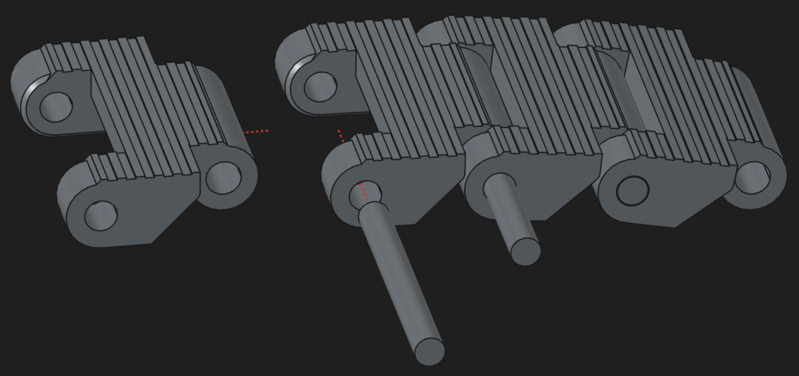
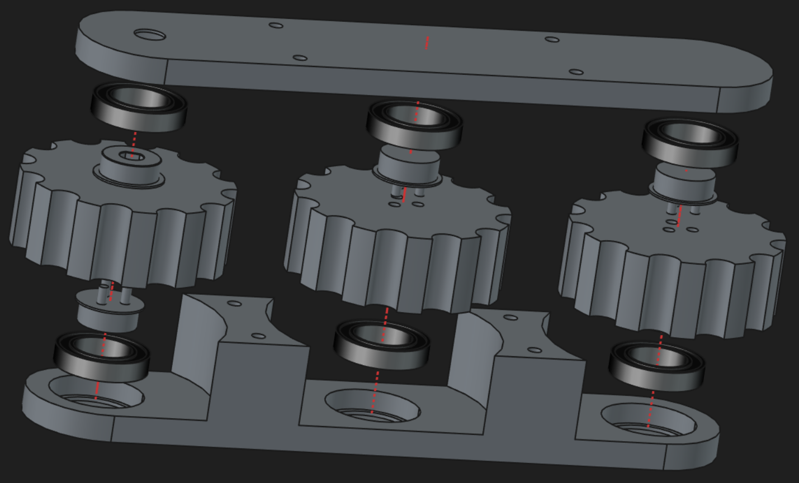
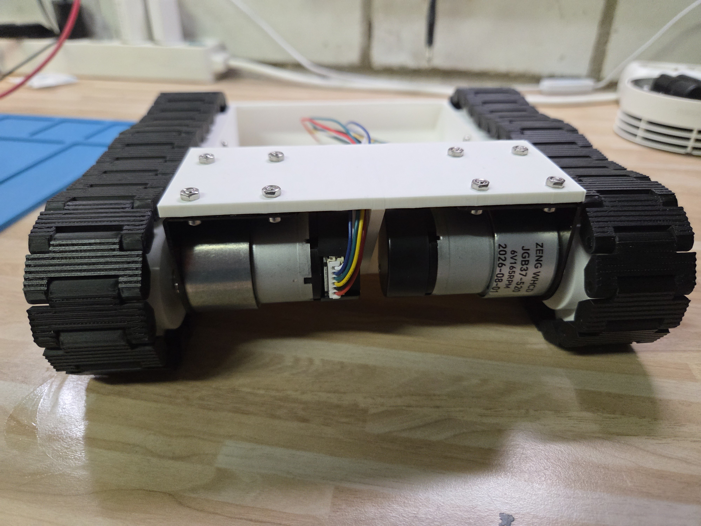

# explorer-robot

A tracked robot platform with LiDAR-based autonomous navigation and sensor-driven
obstacle avoidance, built in Rust on [Embassy](https://embassy.dev/) for the
RP2350 microcontroller. It builds on hardware experience from
[simple-robot](https://github.com/1-rafael-1/simple-robot) and adds a 360° COIN-D6
LiDAR, two VL53L0X rangefinders, an ICM-20948 IMU over SPI, an ST7789 TFT with a
resistive touch panel, and a Grove Vision AI V2 camera — as much as fits on custom
PCB hardware.

## Parts at a glance

The three Cargo workspaces are split by build target so the robot's `thumbv8m`
build never sees the RISC-V or host dependencies (ADR-0040). The paths below are
the current tree.

| Role | Directory | Workspace or target | README |
|---|---|---|---|
| Robot firmware | `src/`, root `Cargo.toml` | Robot workspace — `thumbv8m.main-none-eabihf` | [README.md](README.md) |
| Link contract — the wire and the robot-side core | `remote-protocol/`, `remote-link/` | Robot workspace; host tests on `x86_64-unknown-linux-gnu` | [remote-protocol](remote-protocol/README.md), [remote-link](remote-link/README.md) |
| Bridge — network ⇄ UART1 | `bridge-firmware/` | Its own workspace — `riscv32imc-unknown-none-elf` | [bridge-firmware](bridge-firmware/README.md) |
| Remote — daemon and static app | `remote/` | Host workspace — `x86_64-unknown-linux-gnu` | [remote](remote/README.md) |
| Bench tools — robot and Bridge personas, link probes | `remote/robot-stub/`, `remote/bridge-stub/`, `bridge-firmware/tools/` | Host and Bridge workspaces | [robot-stub](remote/robot-stub/README.md), [bridge-stub](remote/bridge-stub/README.md) |
| Hardware — CAD, EDA and assembly | `cad files/`, `eda files/`, `assembly/` | No Cargo target | [Assembly notes](README.md#assembly) |
| Documentation | `docs/` | No Cargo target | [docs/README.md](docs/README.md) |

## Quickstart

| Role | Start here | First command or step |
|---|---|---|
| Robot | [Robot page](docs/components/robot.md) | `cargo build --workspace --release --target thumbv8m.main-none-eabihf` from the repository root |
| Bridge | [Bridge page](docs/components/bridge.md) | `cd bridge-firmware && cargo build` |
| Remote | [Remote page](docs/components/remote.md) | `cd remote && cargo test --workspace` |
| Bench | [Bench page](docs/components/bench.md) | Wire the bench first, then `cd remote && cargo run -p bridge-stub -- --help` |

## Status

Active development. Drive, perception, UI and calibration are implemented: the
LiDAR driver and the Panel and Touch Panel geometry are real, while the
rangefinders and the AI camera remain stubbed or planned.

Done: the chassis for the new motors and bearings, the async COIN-D6 LiDAR
driver, the async ST7789 driver, and their firmware integration.

Known gaps:

- An async VL53L0X driver, and integration of the front/rear pair.
- A new schematic adapted from simple-robot.
- A full breadboard demonstrator to check the firmware.
- An async Grove Vision AI V2 driver and its integration.
- A new PCB; depending on how mad I feel, maybe an SMD design instead of dev
  boards.

## Hardware

- **MCU:** Raspberry Pi RP2350B (dual-core Cortex-M33).
- **Drive:** 2× JGB37-520 6 V DC motors with Hall encoders, 12× 6802-2RS
  bearings, and a TB6612FNG dual H-bridge motor driver.
- **LiDAR:** COIN-D6 360° spinning dTOF on UART0 (core1), powered on demand
  through a TPS22917 high-side load switch; the driver is integrated and the
  sensor is off at boot.
- **AI Cam:** Grove Vision AI V2 on a PIO UART (core0), with a reserved switched
  5 V branch; not yet integrated. UART1 stays free for the expansion connector.
- **Expansion:** 7-pin 5 V-powered, 3.3 V-logic connector (not yet implemented),
  switched by a TPS22917 on `EXP_PWR` (GPIO32), with UART1 on GPIO36/37.
- **Rangefinders:** 2× VL53L0X ToF, front and rear-down, on separate I2C0/I2C1
  buses (currently stubbed).
- **IMU:** ICM-20948 9-axis on a dedicated SPI bus.
- **Display and input:** ST7789 240×320 Panel driven landscape as a 320×240
  framebuffer, with a resistive touch panel, sharing the SPI1 bus.
- **Power:** 2S LiPo (8.4 V max).

## Assembly

The chassis and running gear are my first CAD design at this level of
complexity. It works as I planned, but I fully expect to find reasons to change,
add, or remove parts as I go. I've printed it in PLA on a 0.4 mm nozzle at
variable layer height with good results — after running the motors for an hour
straight on a riser, nothing looked worn or abraded, there was no PLA dust
anywhere, and all the track pins were still in place.

### Parts required

Purchased:

- 2× JGB37-520 motors (with encoders)
- 2× matching motor brackets (often sold with the motors)
- 12× 6802-2RS ball bearings (6 per track)
- 8× M3 8 mm screws
- 8× M3 40 mm screws
- 16× M3 nuts

Printed:

- 1× chassis main part
- 2× inner track pod parts
- 2× outer track pod parts
- 2× driven sprockets
- 4× freewheeling sprockets
- 6× sprocket holders (one per sprocket)
- 64× track links (32 per track)
- 64× track link pins

### Track assembly

### Track pod assembly

### Overall assembly

### Assembly tips

- The driven sprocket's D-shaft hole is a very tight fit on the motor's D-shaft.
  Push the sprocket onto the shaft at least once before final assembly — the real
  assembly later will be much easier.
- The bearings have to be pressed into the pod shells with some force. Keep them
  even, since everything is a tight fit. I used a rubber mallet, gently.
- After each step, check that the sprockets turn freely in the pod without
  scraping. The screws — combined with the pressure needed to fit the D-shaft —
  can introduce enough strain that something ends up slightly off, causing wobble
  and scraping. It does fit in the end, but takes a little patience.
- The 8 mm screws can be fiddly to get in — use tweezers. After a few minutes of
  colorful cursing they'll go in.

## Read next

- [Documentation index](docs/README.md)
- [Domain glossary](CONTEXT.md)
- Component pages: [robot](docs/components/robot.md),
  [bridge](docs/components/bridge.md), [remote](docs/components/remote.md),
  [bench](docs/components/bench.md)
- Owning decisions: [ADR-0040 — the three workspaces](docs/adr/0040-repo-and-build-layout.md),
  [ADR-0030 — the Link Protocol envelope](docs/adr/0030-link-protocol-envelope.md),
  [ADR-0032 — the robot's Link task](docs/adr/0032-remote-link-task.md),
  [ADR-0037 — reachability and trust](docs/adr/0037-reachability-and-trust.md),
  [ADR-0039 — the daemon relay](docs/adr/0039-remote-daemon-relay.md)
- [MIT license](LICENSE) and [third-party notices](THIRD_PARTY_LICENSES.md)

## License

MIT — see [LICENSE](LICENSE).

Portions are derived from the Raspberry Pi RP2350B Minimal reference design
(MIT); see [THIRD_PARTY_LICENSES.md](THIRD_PARTY_LICENSES.md) for details.
