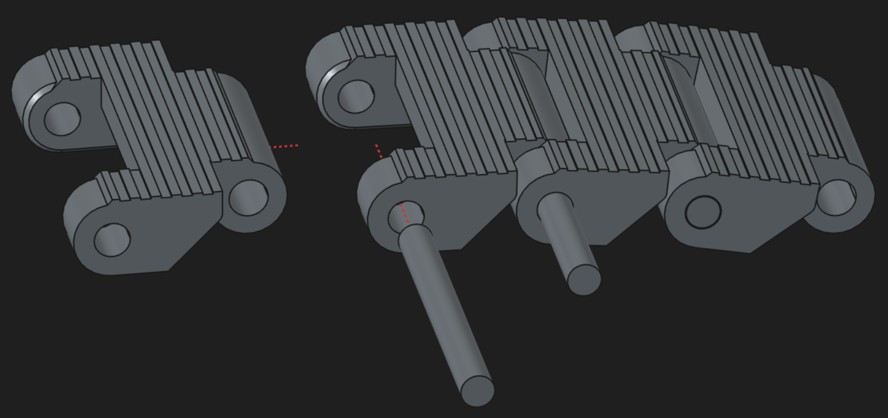
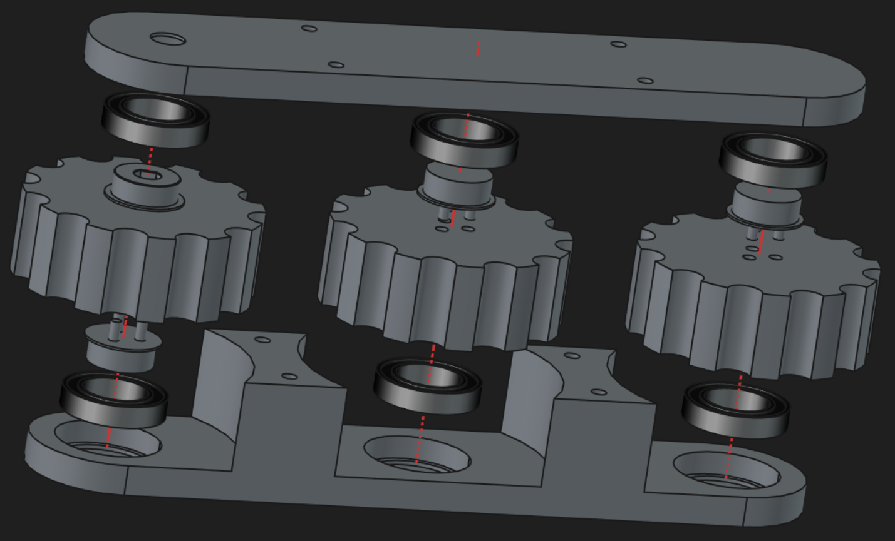
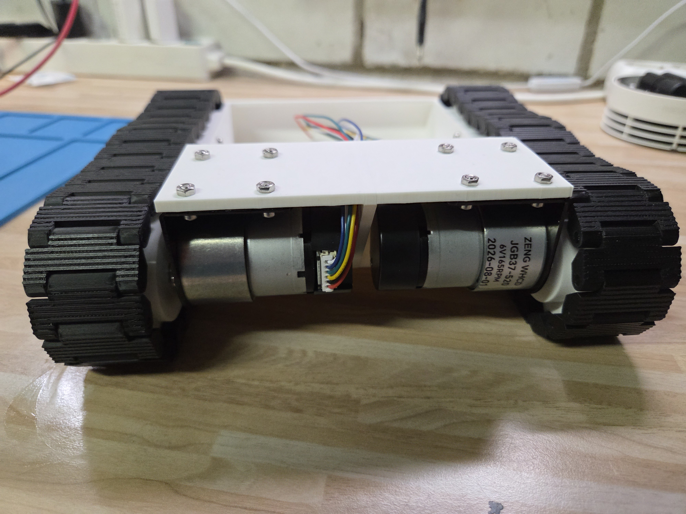

# Hardware

This is the mechanical and electrical source for explorer-robot: the FreeCAD
chassis and running gear, the KiCad board, and the assembly photos. It is the
hardware part of the repository, alongside the robot, Bridge and Remote
workspaces; the repo map is in [architecture.md](../docs/architecture.md) and
the [repository README](../README.md) is the front door.

## BOM / Parts required

Purchased:

- 2× JGB37-520 motors (with encoders)
- 2× matching motor brackets (often sold with the motors)
- 12× 6802-2RS ball bearings (6 per track)
- 8× M3 8 mm screws
- 8× M3 40 mm screws
- 16× M3 nuts

Printed:

- 1× chassis main part
- 2× inner track pod parts
- 2× outer track pod parts
- 2× driven sprockets
- 4× freewheeling sprockets
- 6× sprocket holders (one per sprocket)
- 64× track links (32 per track)
- 64× track link pins

## Print notes

The chassis and running gear are my first CAD design at this level of
complexity. It works as I planned, but I fully expect to find reasons to change,
add, or remove parts as I go. I've printed it in PLA on a 0.4 mm nozzle at
variable layer height with good results — after running the motors for an hour
straight on a riser, nothing looked worn or abraded, there was no PLA dust
anywhere, and all the track pins were still in place.

## Assembly

### Track assembly

### Track pod assembly

### Overall assembly

### Assembly tips

- The driven sprocket's D-shaft hole is a very tight fit on the motor's D-shaft.
  Push the sprocket onto the shaft at least once before final assembly — the real
  assembly later will be much easier.
- The bearings have to be pressed into the pod shells with some force. Keep them
  even, since everything is a tight fit. I used a rubber mallet, gently.
- After each step, check that the sprockets turn freely in the pod without
  scraping. The screws — combined with the pressure needed to fit the D-shaft —
  can introduce enough strain that something ends up slightly off, causing wobble
  and scraping. It does fit in the end, but takes a little patience.
- The 8 mm screws can be fiddly to get in — use tweezers. After a few minutes of
  colorful cursing they'll go in.

## Safety

- **Power source:** 2S LiPo, 8.4 V fully charged. Do not exceed 8.4 V.
- **Switched 5 V branch:** the LiDAR and the reserved AI-camera branch sit behind
  TPS22917 high-side load switches. The expansion connector is 5 V-powered and
  switched on `EXP_PWR`.
- **Logic levels:** all logic is 3.3 V. Never present 5 V to an RP2350 or Bridge
  GPIO.
- **No USB + J9:** never power from USB and `J9` at once. Most C3 dev boards tie
  VBUS to the 5 V pin, so both together back-feeds the switched 5 V rail and, with
  the robot off, back-powers the RP2350 through the Link Port's series resistors.

The bench procedure and the current wiring live in the
[bench page](../docs/components/bench.md); follow it there rather than from this
summary.

## Source files

- `cad/` — FreeCAD projects (`*.FCStd`) and the exported `print files/*.3mf`.
- `eda/` — the KiCad project under `eda/explorer-robot/`: schematic sheets, PCB,
  footprints and 3D models.
- `assembly/` — the assembly photos and renderings used above.

## Third-party material

The `rp235xb` footprints and STEP models under `eda/explorer-robot/` are derived
from the Raspberry Pi RP2350B Minimal reference design. See
[THIRD_PARTY_LICENSES.md](../THIRD_PARTY_LICENSES.md) for the notice.
